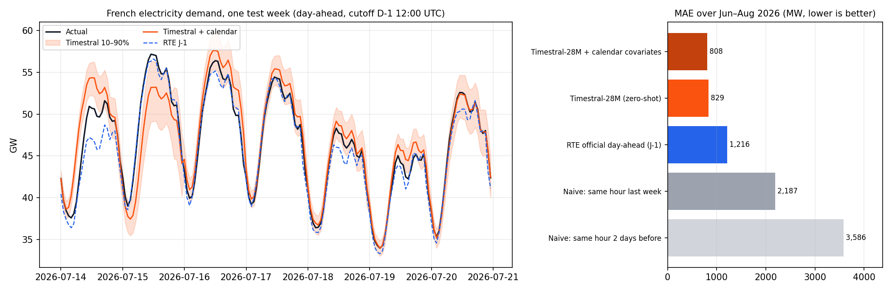
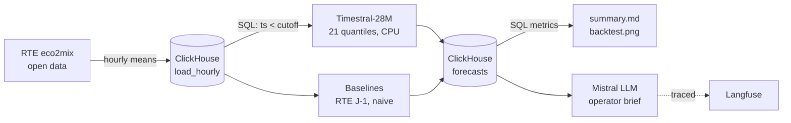

# Timestral vs RTE: forecasting French electricity demand a day ahead

**Can a zero-shot time-series foundation model, running on a laptop CPU, match the French grid operator's official day-ahead forecast?**

On a pre-registered backtest over **every day of June–August 2026**, [Mistral's Timestral-28M](https://github.com/mistralai/timestral) forecast hourly French electricity demand with an **MAE of 808 MW (1.74%)**, against **1,216 MW (2.66%)** for RTE's official J-1 forecast. It was better on **76% of days**. All data, forecasts and scores live in **ClickHouse**, and the metrics are plain SQL.



| Model | MAE (MW) | MAPE | MASE vs weekly naive | 10–90% interval coverage | Days better than RTE J-1 |
|---|---:|---:|---:|---:|---:|
| **Timestral-28M + calendar covariates** | **808** | **1.74%** | **0.37** | 85% | 76% |
| Timestral-28M (zero-shot, no covariates) | 829 | 1.79% | 0.38 | 86% | 78% |
| RTE official day-ahead (J-1) | 1,216 | 2.66% | 0.56 | — | — |
| Naive: same hour last week | 2,187 | 4.74% | 1.00 | — | 23% |
| Naive: same hour 2 days before | 3,586 | 8.08% | 1.64 | — | 16% |

92 test days, and every model is scored on the same 2,206 hours. The full output is in [`results/summary.md`](results/summary.md).

## How the test is kept honest

- **Pre-registered.** [`protocol.json`](protocol.json) fixes the data window, test days, cutoff rule, models, baselines and metrics. It was committed *before* the first forecast ran ([commit b6d544d](https://github.com/qudotcom/timestral-vs-rte/commit/b6d544d)). Every run stores the protocol's SHA-256 next to its results.
- **No look-ahead.** For each test day D, the model only sees data up to **D-1 12:00 UTC**. The cutoff is enforced inside the SQL query that builds each context window (`ts < cutoff`), and `tests/` checks it.
- **No tuning on the test window.** Checkpoint (28M) and context length (4,096 h) were chosen up front. Timestral is used zero-shot, with no fine-tuning.
- **Same hours for everyone.** Metrics are computed only on hours where every model has a forecast.
- **Sensitivity check (exploratory, not pre-registered).** RTE's dataset does not record when its J-1 forecast is issued. Moving the cutoff 12 hours earlier, to D-1 00:00 UTC (so Timestral forecasts 24 to 47 hours ahead), Timestral still wins: **1,087 MW vs 1,216 MW**, better on 65% of days ([`results/sensitivity.md`](results/sensitivity.md)).

### Limits

- **Summer only.** June–August demand depends less on weather. Timestral sees **no temperature data**, while RTE's forecast uses weather, so winter (heating load) is the real test. Adding temperature as a covariate is the obvious next step.
- **Holidays.** With no holiday calendar, Timestral overshoots on 14 July (visible in the chart).
- RTE's J-1 values are hourly means of its published 15-minute forecast, aligned to UTC hours.

## Pipeline



1. **Data**: RTE eco2mix national consumption (definitive data, then real-time for the live forecast) from the ODRE open-data API, resampled to hourly means.
2. **Store**: ClickHouse, either in-process via [chDB](https://github.com/chdb-io/chdb) or a ClickHouse server/Cloud through `clickhouse-connect`. On Windows, where chDB has no wheel, the same SQL runs on DuckDB.
3. **Forecast**: Timestral returns 21 quantiles per hour; the median is the point forecast and 10–90% is the interval. One variant adds known-future calendar covariates (hour of day, day of week, weekend).
4. **Score**: MAE, MAPE, MASE, interval coverage and daily wins against RTE, computed in SQL ([`tvr/backtest.py`](tvr/backtest.py)).
5. **Live**: `tomorrow` forecasts the next day from the latest real-time data.
6. **Brief (optional)**: a Mistral model turns the forecast into a short operator brief, traced in Langfuse. *Forecast first, then let the LLM explain*: every number comes from Timestral and the backtest, and the prompt forbids inventing figures. The brief is a draft for a human to approve.

## Run it

```bash
pip install -r requirements.txt           # Python >= 3.10, torch >= 2.4 (CPU is fine)
python -m tvr backtest                     # the pre-registered backtest + sensitivity check
python -m tvr tomorrow                     # live forecast for the next day
pytest -q                                  # leakage, protocol and scoring tests
```

The store defaults to chDB when it is installed, otherwise DuckDB. Choose one with `--store chdb|clickhouse|duckdb`. For a ClickHouse server or ClickHouse Cloud, set `CLICKHOUSE_HOST`, `CLICKHOUSE_PORT`, `CLICKHOUSE_USER` and `CLICKHOUSE_PASSWORD`.

The operator brief needs `pip install -r requirements-extras.txt` and `MISTRAL_API_KEY` (model set by `MISTRAL_MODEL`, default `mistral-large-latest`). Langfuse tracing turns on with `LANGFUSE_PUBLIC_KEY` and `LANGFUSE_SECRET_KEY`.

```bash
python -m tvr brief
```

Without a key, it prints the exact facts it would send.

## Data and licences

- Electricity data: RTE eco2mix via [ODRE](https://odre.opendatasoft.com/), open licence (Licence Ouverte / Etalab).
- Timestral weights: Mistral AI, [Modified MIT licence](https://huggingface.co/mistralai/Timestral-28M); inference code Apache-2.0.
- This repository: MIT.

Built by [Abdelouahed Tahri](https://qudotcom.github.io) ahead of the Mistral × ClickHouse "Ahead of Time" hackathon, Paris, December 2026.
